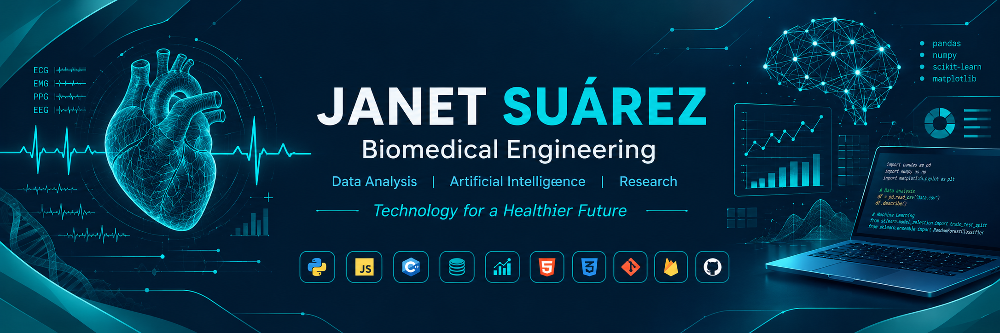

  

### Biomedical Engineering

**Data Analysis &nbsp;|&nbsp; Artificial Intelligence &nbsp;|&nbsp; Research**

*Technology for a Healthier Future*

 

---

## About Me

Biomedical Engineering student at Universidad Autónoma de Aguascalientes, interested in data analysis, artificial intelligence, and scientific research. I develop technological projects involving software development, data processing, and biomedical signal analysis, exploring computational approaches to real-world problems.

<table>
  <tr>
    <td width="50%" valign="top">

**Interests**

- Data Analysis
- Artificial Intelligence
- Machine Learning
- Biomedical Signal Processing

</td>
    <td width="50%" valign="top">

**Also exploring**

- Scientific Research
- Software Development
- Technological Innovation

</td>
  </tr>
</table>

---

## Technologies

<table>
  <tr>
    <td width="50%" valign="top">

**Programming Languages**

</td>
    <td width="50%" valign="top">

**Web Development**

</td>
  </tr>
  <tr>
    <td width="50%" valign="top">

**Data Analysis**

</td>
    <td width="50%" valign="top">

**Databases and Tools**

</td>
  </tr>
</table>

<b>Additional tools</b>

 

---

## Featured Projects

<table>
  <tr>
    <td width="50%" valign="top">
      <h3>SGM-H</h3>
      
<b>Hospital service order management system</b>

      
Web application developed during my social service at Hospital General Tercer Milenio to manage service orders related to hospital equipment maintenance.

      
<b>Goal:</b> organize and track maintenance service orders.

      

        
        
      

      
    </td>
    <td width="50%" valign="top">
      <h3>Analisis_Datos_Biomedicos-</h3>
      
<b>Biomedical data analysis with Python</b>

      
Academic project from Tecnolochicas PRO focused on ECG signal analysis and the exploration of relationships between biometric parameters using Python.

      
<b>Goal:</b> explore ECG signals and biometric parameters.

      

        
        
      

      
    </td>
  </tr>
  <tr>
    <td width="50%" valign="top">
      <h3>BIO_PULSE</h3>
      
<b>ECG signal monitoring</b>

      
Project for the acquisition, processing, and visualization of electrocardiographic signals, with a web interface to observe the signal in real time.

      
<b>Goal:</b> acquire, process, and visualize ECG signals.

      

        
        
        
        
        
      

      
    </td>
    <td width="50%" valign="top">
      <h3>MONITOREO_EMG-</h3>
      
<b>EMG signal monitoring</b>

      
Electromyographic signal monitoring project that integrates signal acquisition and visualization to explore signal behavior.

      
<b>Goal:</b> acquire and visualize EMG signals.

      

        
        
      

      
    </td>
  </tr>
</table>

---

## Education

- **Biomedical Engineering** — Universidad Autónoma de Aguascalientes
- **Tecnolochicas PRO** — Data Science
- **Samsung Innovation Campus** — 2026 training program
- **Google** — Machine Learning Crash Course

<b>Teaching experience</b>

 

- **Remote programming instructor** for teenagers at Tecnolochicas PRO.

---

## Contact

I am interested in learning, collaborating, and taking part in technology projects related to software development, data analysis, and artificial intelligence.

  

